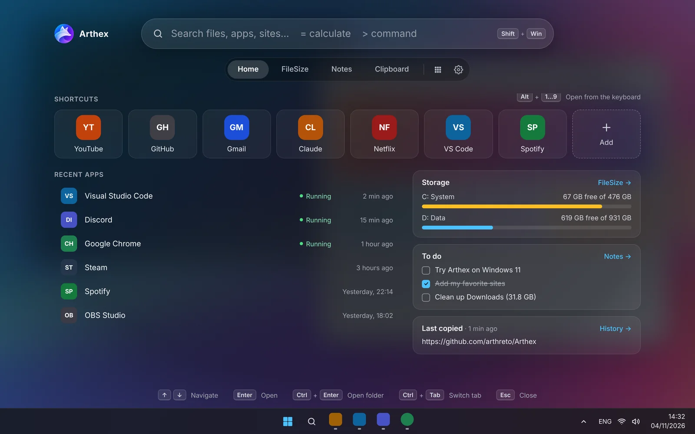
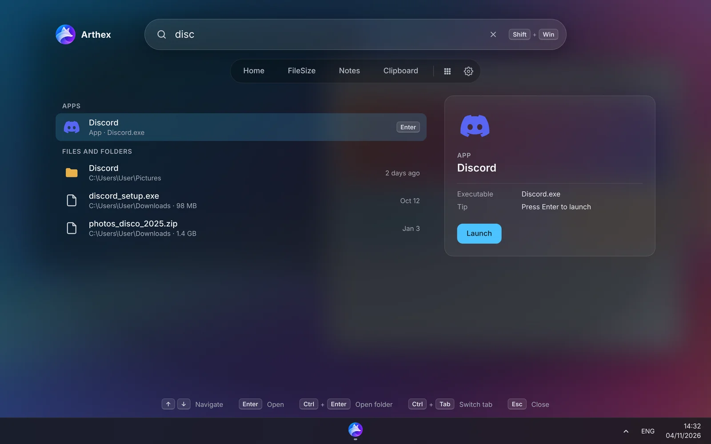
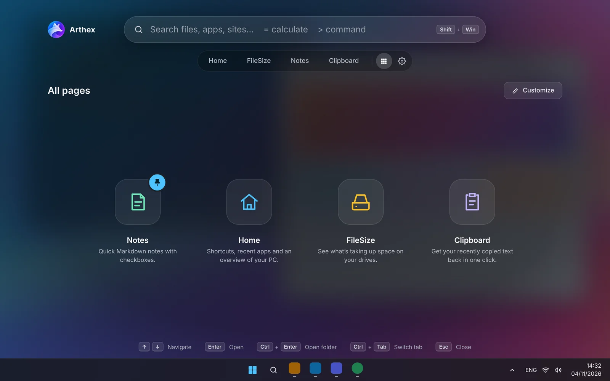
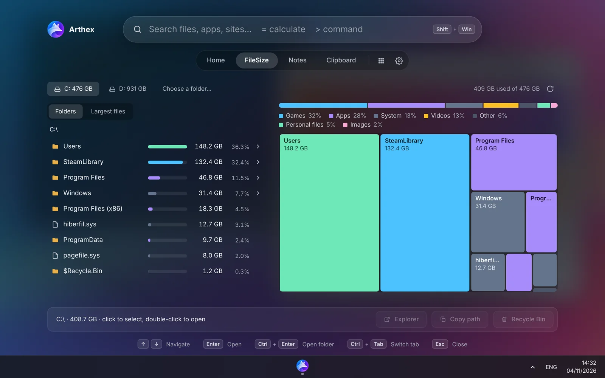
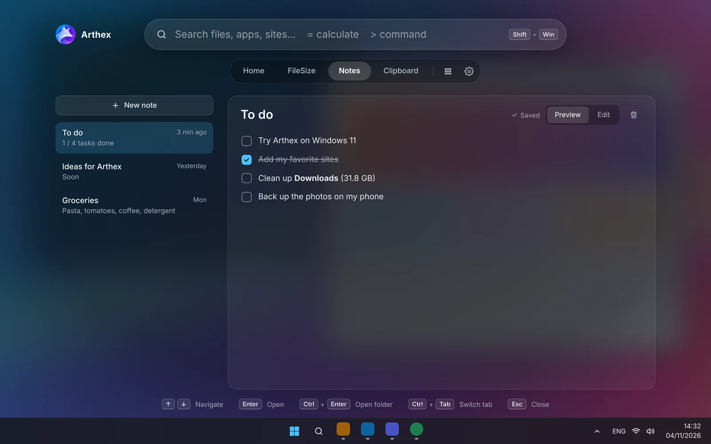
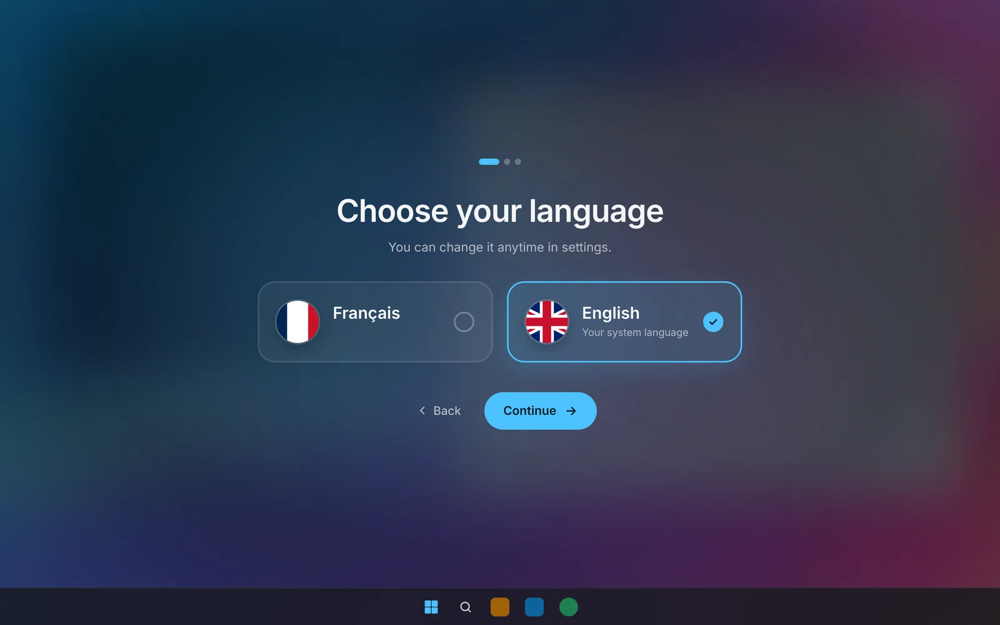
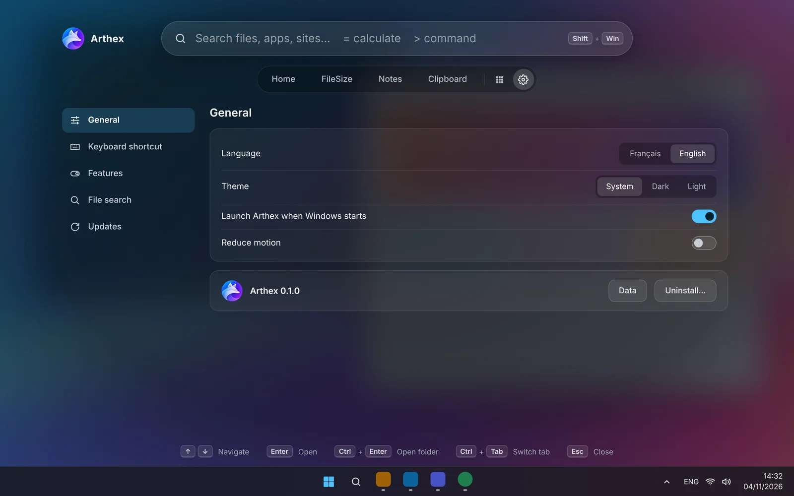

  

<h1 align="center">Arthex</h1>

A fast overlay for your shortcuts, files and everyday tools. Press <kbd>Shift</kbd> + <kbd>Win</kbd>.

  

Arthex lives in the system tray and opens on top of everything. It shows as a full-screen translucent layer that blends into the desktop.

- Search files and folders instantly.
- Launch apps and websites.
- Calculate and run system commands.
- See what fills your disk.
- Keep notes and your clipboard history at hand.

It is built for Windows 11. macOS and Linux get a simplified version.

> **Status:** early development. The overlay, tray, settings, themes and languages work. The pages below arrive step by step.

## Features

|               |                                                                                                                         |
| ------------- | ----------------------------------------------------------------------------------------------------------------------- |
| **Search**    | Files and folders (own index, much faster than Windows Search), apps, websites, calculator (`=`), system commands (`>`) |
| **Home**      | Shortcuts to websites and software, recent apps, storage, notes and last copied item                                    |
| **FileSize**  | Folder tree, treemap and largest files, with deletion to the Recycle Bin                                                |
| **Notes**     | Markdown notes (headings, bold, italic, checkboxes) with Preview and Edit modes                                         |
| **Clipboard** | Text history kept in memory only, never written to disk                                                                 |
| **System**    | Lock, sleep, restart, shut down, scheduled shutdown                                                                     |
| **All pages** | Every page in one launcher. Pin your favourites to the top, choose the tab bar, turn pages off.                         |
| **Updates**   | Signed automatic updates from GitHub Releases, with release notes at the next launch                                    |

Languages: English and French.

<table>
  <tr>
    <td width="50%"> <b>Search</b>: apps, files and folders, with a preview</td>
    <td width="50%"> <b>All pages</b>: every page in one launcher</td>
  </tr>
  <tr>
    <td> <b>FileSize</b>: see what takes up space</td>
    <td> <b>Notes</b>: quick Markdown notes with checkboxes</td>
  </tr>
  <tr>
    <td> <b>First launch</b>: language, theme and startup</td>
    <td> <b>Settings</b></td>
  </tr>
</table>

Screenshots show the validated design. Some pages are still in development.

## Installation

1. Download `Arthex_x.y.z_x64-setup.exe` from the [Releases](https://github.com/arthreto/Arthex/releases) page.
2. Run it. No administrator rights are needed, and you can choose the install folder.

The installer is not code-signed yet, so Windows SmartScreen may warn you: click **More info → Run anyway**.

To uninstall, use the tray menu (**Uninstall…**) or Windows Settings → Apps.

## Use

| Keys                                         | Action                                        |
| -------------------------------------------- | --------------------------------------------- |
| <kbd>Shift</kbd> + <kbd>Win</kbd>            | Open or close Arthex (changeable in Settings) |
| <kbd>↑</kbd> <kbd>↓</kbd> · <kbd>Enter</kbd> | Choose and open a result                      |
| <kbd>Ctrl</kbd> + <kbd>Enter</kbd>           | Open the containing folder                    |
| <kbd>Ctrl</kbd> + <kbd>Tab</kbd>             | Next tab                                      |
| <kbd>Esc</kbd>                               | Clear the search, then close                  |

Arthex never needs administrator rights and sends no telemetry. The network is used only for website icons and update checks.

## Credits

Arthex is made by [arthreto](https://github.com/arthreto).

- Built with [Tauri](https://tauri.app), [Svelte](https://svelte.dev) and [Rust](https://www.rust-lang.org).
- Want to build it, add a page or a language? See the [developer guide](docs/DEVELOPMENT.md).

Released under the [PolyForm Noncommercial 1.0.0](LICENSE) license:

- you may use, study and modify Arthex, as long as you credit the author;
- commercial use is not allowed, including for modified versions.
